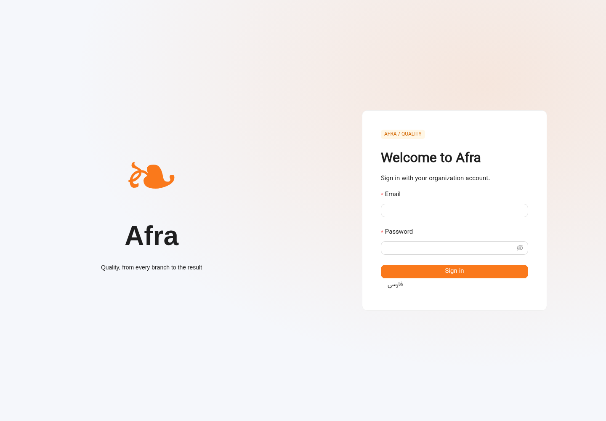
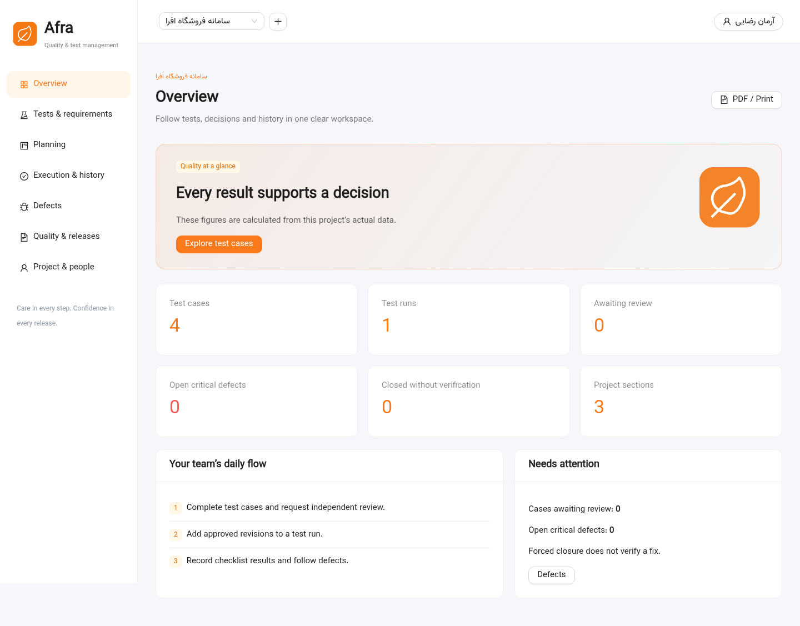
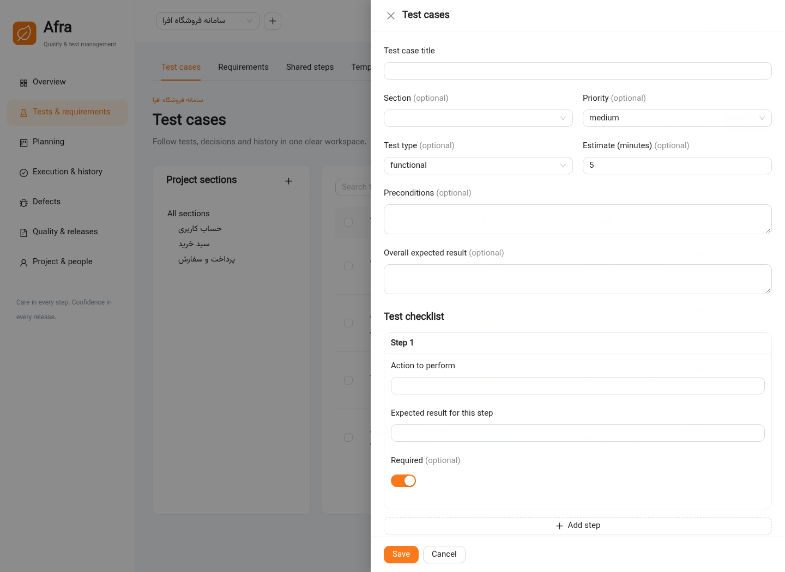
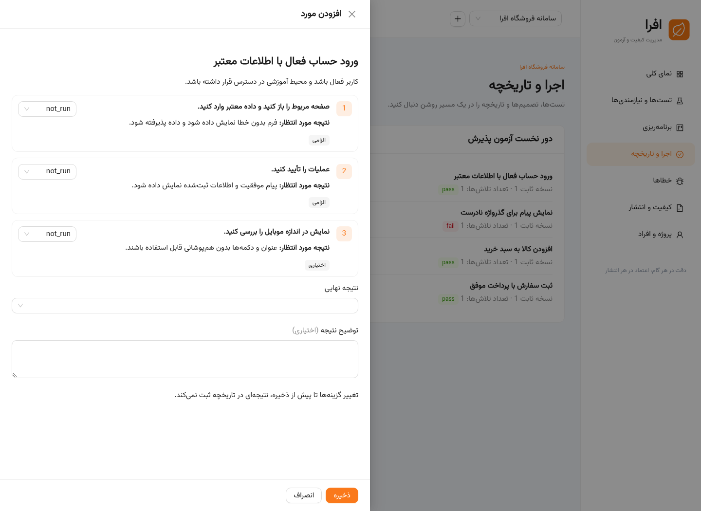

# Afra user guide

Edition 5 — 19 November 2026. This guide combines QA learning with the target Afra workflow. **The new Laravel/React implementation is incomplete.** Sections marked “target workflow” describe the approved specification and historical HTML design, not an available production feature. Check the implementation-status document. Images explicitly identified as React are actual local application screenshots using synthetic training data.

# Chapter 1 — Quality assurance and test design

## 1. Quality assurance and testing

Quality assurance (QA) improves how a team builds and checks a product. Testing evaluates its behavior and provides evidence. Testing reduces uncertainty; a passing set of tests does not prove that no defects exist. Agree on quality criteria early and keep requirements clear and testable.

A requirement describes an expected capability or constraint. Acceptance criteria explain observable success. Example: “An active registered user with valid credentials reaches the dashboard; invalid credentials produce a generic error and no session.” Include permissions, expiry, validation and error handling, not only the happy path.

## 2. What a test case contains

A test case is a repeatable check of a specific behavior. It should let another tester reach a comparable conclusion. Include a precise title, requirement link, preconditions, data, actions, expected results, priority and responsible tester. Keep one primary purpose per case. “Check login” is vague; “Active account signs in with valid credentials” is testable.

Training example:

* Preconditions: account is active, unexpired and assigned to the project; application is reachable.
* Data: a synthetic training email and valid password delivered securely. Never place actual credentials in exported reports.
* Step1: enter the email and password. Expected: fields accept input without exposing the password.
* Step2: submit. Expected: dashboard appears and the signed-in identity is correct.
* Step3: sign out. Expected: application access requires authentication again.

Each checklist item needs **its own expected result**. Overall expected result summarizes success but does not replace per-step observations. A required step must succeed for overall Pass. An optional step is deliberately non-blocking, not a way to hide a failure.

## 3. Selecting useful test data

Use equivalence classes (representative valid/invalid values), boundary values (just below/at/above limits), decision tables for combinations of rules, and state transitions. For an expiry boundary, test immediately before and at the next Tehran day boundary. For an upload limit, test below/at/above20MiB and a misleading file extension. Include negative and permission tests.

Priority is the order/importance of running a test; defect severity is impact of a discovered problem. A high-priority regression test and a medium-severity defect are not contradictory. Smoke tests check essential paths; regression tests check that existing behavior survives change. Manual performance/security checks are permitted; this scope does not connect automated-test systems.

## 4. Review and versioning

Ask an independent person to review clarity, reproducibility, data, coverage and expected results. Authors cannot approve their own revision. Changes create a new draft. Executions freeze the approved revision so a later edit does not rewrite evidence.

Requirement content revisions differ from release labels. If a requirement changes, inspect affected cases. Compatibility confirmation means “this case still covers this requirement revision”; it does not mean the changed product has already been tested.

## 5. Results, evidence and defects

Pass: observed behavior matches required expectations. Fail: an expected behavior is violated. Blocked: execution cannot proceed because of a prerequisite/environment problem. Skipped: an intentional, explained non-execution. Not run: no recorded execution. Explain exclusions rather than reporting them as success.

A useful defect includes concise title, build/environment, exact steps, expected/actual behavior, severity and evidence. Link it to the recorded failed item. Avoid personal data in screenshots. Mark resolved only when a fix is ready for checking. Retesting checks the reported fix; regression checking looks for damage to related behavior.

Normal closure requires a linked Pass recorded **after** the fix was marked resolved. If you see that warning: open the defect, choose Retest, execute its linked item, record Pass if every required expectation succeeds, then close. If it still fails, record Fail and reopen/follow up. Never record Pass merely to remove a warning.

Forced closure is an authorized business decision, not proof of repair. Record a meaningful reason and explicit confirmation; reports retain “closed without verification.”

## 6. Reading quality reports

Distinguish unique cases from execution variants. Two cases on two configurations with two data rows yield eight items. Coverage is not simply the number of links; verification needs fresh results against the correct requirement revision. A green percentage without a denominator, stale-data treatment and required-variant rules can mislead. Read open critical defects, blocked work and release gates with the progress rate.

# Chapter 2 — Working with Afra

## 1. Sign in and first password change — React application

1. Open the organization’s Afra address. For local development use the address in the setup guide.
2. Enter the email and initial password provided by your administrator.
3. If password change is required, supply current password, a different new password of12–128 characters and confirmation. Save.
4. Sign in again. Never send credentials through case comments or screenshots.

If sign-in fails, check credentials and ask an administrator to verify active state/expiry. Error details should never reveal other accounts. Changing/resetting a password invalidates previous sessions.

## 2. Select a project and navigate — React application

Choose the project in the header. The seven navigation groups consolidate related functions; use the tabs within a group. The avatar menu contains profile, password, appearance/language and logout. Choose light, dark or system; choose English/Persian. Calendar displays remain Solar Hijri in both languages. On mobile use bottom navigation and More; editors open as bottom sheets.

## 3. Create sections and cases — React core

1. A system administrator creates a project with the + control beside project selection.
2. A project administrator opens Tests & requirements and adds a section with the tree’s + control. Choose a parent to create a nested section.
3. Choose Add, enter a descriptive title, section, priority/type, estimate and preconditions.
4. For every checklist row, enter the action and its expected result, and set Required appropriately.
5. Use Add step **below** the rows. Save. Validation messages explain missing or invalid fields; entered data should remain available for correction.
6. Review the draft. Editing produces a new revision; an existing run is unchanged.

## 4. Request independent review — React core

From the case row’s Review menu choose Request review. An authorized reviewer other than the revision author selects Approve or Return to draft. Resolve comments and resubmit as necessary. A version conflict means someone edited the source; reload before deciding. Being a system administrator does not permit self-approval.

## 5. Plans, views, shared steps and requirements — target workflow

Create requirements with observable acceptance criteria; link exact revisions to cases. Review change impacts before planning. Reuse an approved shared-block version or detach its steps; update consumers explicitly. Templates preserve per-step expected results. Saved views hold personal/team conditions and columns; dynamic plans reevaluate them at preview, then freeze scope.

Choose a plan, release and configuration profile. Review required/optional rows and dataset expansion. Correct unresolved variables. Confirm unique-case and item counts. If sources changed since preview, refresh preview rather than forcing an obsolete selection.

**Current implementation note:** basic record forms do not implement these full domain workflows. They are not a substitute for the target planning/review/matrix feature.

## 6. Start an execution and record results — React core

1. Select current approved cases in the case list and choose Create run from selection.
2. Name the run and save. Pending/draft or changed cases are rejected until refreshed and approved.
3. Open Execution & history, choose the run and Execute.
4. Open an item’s Record result. Read frozen preconditions and each expected result.
5. Select Pass/Fail/Skipped/Not run per step. Select overall result and provide required explanations.
6. Save explicitly. Selection alone does not create a historical result.
7. Reopen the run to inspect attempts. Repeating a recorded request must not duplicate it. Each new attempt remains visible historically.

Per-user resumable drafts, time tracking, configuration expansion and the full evidence interface are target workflows still requiring implementation in the current build.

## 7. Defects, retesting and closure — React core

Create a defect for a recorded failed run item; include title, description and severity. The current form requires the exact run-item ID; an integrated Create defect shortcut is still needed. Open details to read actor/history descriptions. Move to In fix, then Resolved with a reason when a fix is available.

The Retest control becomes available when resolved. It creates a linked execution of the exact source item. Record the actual outcome. Ordinary closure requires a new linked Pass after resolution. A permitted administrator may choose Forced closure, confirm the lack of verification and explain the decision. It produces no successful test result. Preserve failed results rather than rewriting them.

## 8. People, profile and access — partly implemented

System accounts and project memberships are distinct. Creating a system account does not itself grant access to every project. Add an existing account to the intended project as administrator/tester/reviewer/viewer. Use least privilege. Full account fields/avatar/group/action/section editors are target features; current core APIs provide only part of them.

Self-service profile changes must not change role/status/expiry. Administrators handle organizational identity fields and corrections. Expiry ends the selected Tehran day. Inactive/expired users cannot continue using an old session. Administrator password reset requires secure delivery of the new temporary value; old passwords cannot be recovered.

## 9. Reports, service usage and release decisions — target workflow

Overview shows actual project counts. The current print button is basic browser printing and **not** the final professional report engine. Target reports provide filters, all matching records, A4 portrait/landscape preview, repeated headers, split matrices and Shamsi preparation metadata. Review counts and missing/failed variants before export.

Only system administrators manage enabled internal services, client credentials, scopes, projects and delegation. The progress service is project-specific. Secrets are shown once; rotate rather than trying to recover them. Usage reports include failures and rate limits with median/p95 over the complete filtered set. These service workflows are not implemented in the current core.

## 10. Troubleshooting and responsible use

* 401/session ended: sign in again; administrators may have revoked or expired access.
* 403/hidden action: ask the project access manager; do not try another user’s identifier.
*409/conflict: preserve your text, reload current source and reconcile changes.
*422/validation: correct the named fields and save again.
*Required step not passed: inspect the actual outcome; do not fabricate success.
*Cannot close defect: mark fixed as Resolved, run its linked Retest and record the real result after resolution, or use explicitly authorized forced closure with reason.
*Missing planned feature: consult implementation status; historical HTML may demonstrate design that the new API has not yet delivered.

Use training data for screenshots, redact private information and follow organization policy for credentials and attachments. Contact operations for backups/restoration; the software does not replace the organization’s backup process.
