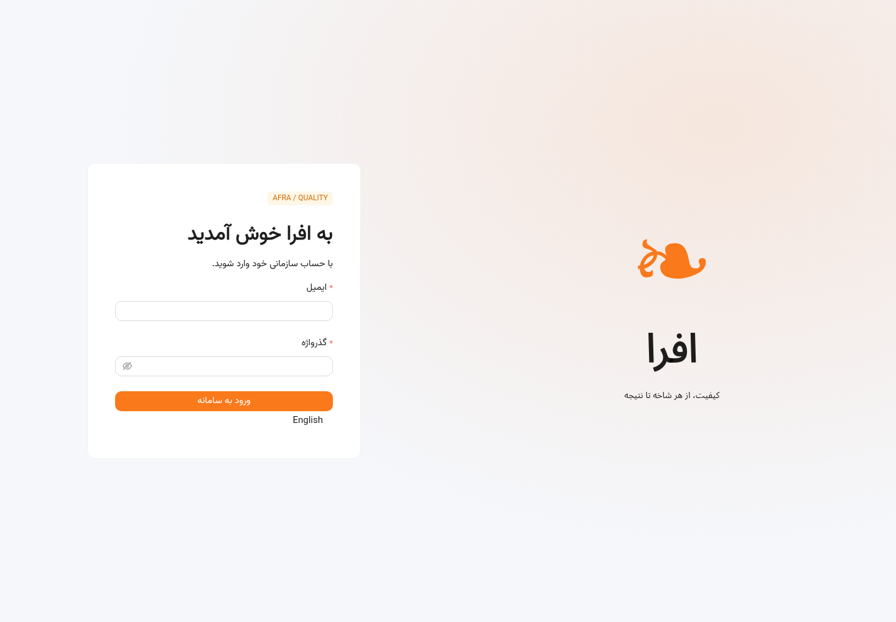
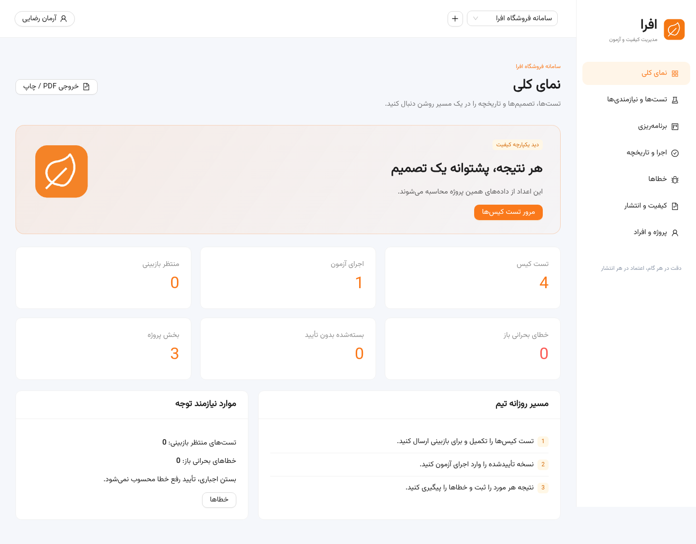
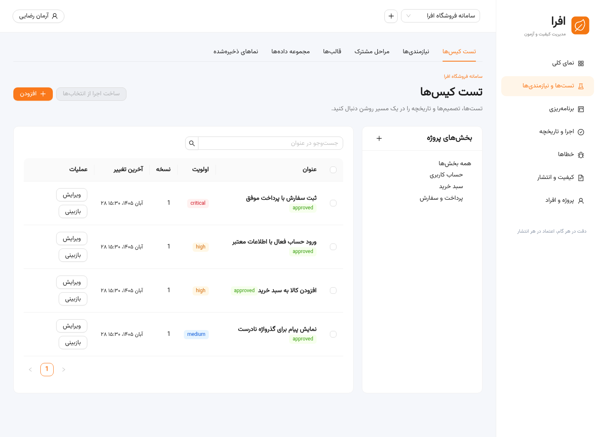
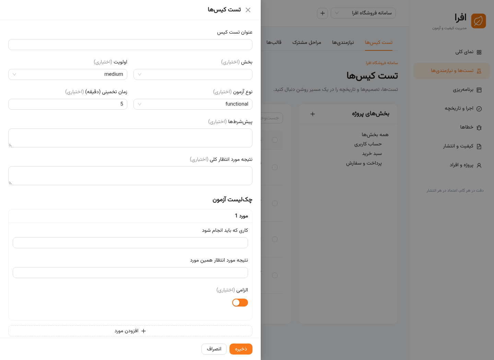
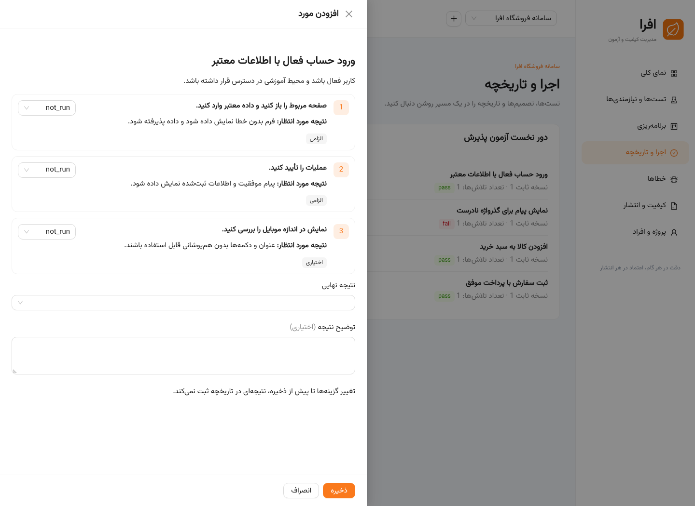
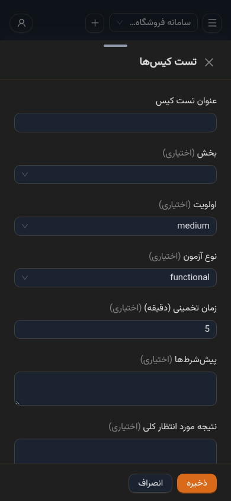

# راهنمای افرا

ویرایش۵ — ۲۸ آبان۱۴۰۵. این راهنما آموزش مفاهیم و گردش کار هدف افرا را پوشش می‌دهد. **پیاده‌سازی جدید لاراول و ری‌اکت هنوز کامل نیست.** بخش‌های «گردش کار هدف» شرح طراحی تأییدشده‌اند، نه قابلیت آماده بهره‌برداری. وضعیت واقعی را در سند وضعیت پیاده‌سازی ببینید. تصویرهایی که با عنوان ری‌اکت مشخص شده‌اند از خود برنامه محلی با داده آموزشی ساختگی گرفته شده‌اند.

# فصل اول — تضمین کیفیت و طراحی آزمون

## ۱. تضمین کیفیت و آزمون چیست؟

تضمین کیفیت به بهبود روش ساخت و بررسی محصول کمک می‌کند. آزمون، رفتار محصول را بررسی و شواهد فراهم می‌کند. موفق شدن چند آزمون ثابت نمی‌کند که هیچ خطایی وجود ندارد. از ابتدا درباره معیار کیفیت توافق کنید و نیازمندی روشن و آزمون‌پذیر بنویسید.

نیازمندی، قابلیت یا محدودیت مورد انتظار است؛ معیار پذیرش توضیح می‌دهد موفقیت چگونه مشاهده می‌شود. نمونه: «کاربر فعال و ثبت‌شده با اطلاعات درست وارد نمای کلی شود؛ اطلاعات نادرست پیام عمومی بدهد و نشست نسازد.» حالت خطا، دسترسی و انقضا را هم در نظر بگیرید.

## ۲. تست کیس دقیق چه اجزایی دارد؟

تست کیس، بررسی تکرارپذیر یک رفتار مشخص است؛ فرد دیگری باید بتواند با اجرای آن به نتیجه قابل مقایسه برسد. عنوان دقیق، نیازمندی مرتبط، پیش‌شرط، داده، اقدام‌ها، نتیجه مورد انتظار، اولویت و مسئول را ثبت کنید. «بررسی ورود» مبهم است؛ «ورود حساب فعال با گذرواژه درست» قابل بررسی است.

نمونه آموزشی:

- پیش‌شرط: حساب فعال و منقضی‌نشده، عضو پروژه و برنامه در دسترس باشد.
- داده: ایمیل آموزشی و گذرواژه معتبر که امن تحویل داده شده؛ رمز واقعی در گزارش قرار نگیرد.
- گام۱: ایمیل و رمز را وارد کنید. انتظار: ورود اطلاعات ممکن باشد و رمز آشکار نشود.
- گام۲: دکمه ورود را بزنید. انتظار: نمای کلی و نام درست کاربر دیده شود.
- گام۳: خارج شوید. انتظار: دسترسی بعدی دوباره نیازمند ورود باشد.

هر مورد چک‌لیست باید **نتیجه مورد انتظار خودش** را داشته باشد. نتیجه کلی جای نتیجه هر گام را نمی‌گیرد. مورد الزامی باید موفق شود؛ اختیاری کردن راه پنهان کردن شکست نیست.

## ۳. انتخاب داده و روش طراحی

از دسته‌های هم‌ارز معتبر و نامعتبر، مرزها (کمی کمتر، برابر و بیشتر از حد)، جدول تصمیم و تغییر وضعیت استفاده کنید. برای انقضا، درست پیش از مرز روز بعد تهران و خود مرز را بسنجید. برای بارگذاری، کمتر، برابر و بیشتر از۲۰MiB و پسوند فریبنده را امتحان کنید. آزمون منفی و آزمون دسترسی را فراموش نکنید.

اولویت آزمون، اهمیت یا ترتیب اجراست؛ شدت خطا، اثر مشکل کشف‌شده است. آزمون سریع حیاتی، مسیرهای اصلی را می‌سنجد؛ آزمون بازگشتی بررسی می‌کند تغییر جدید رفتارهای قبلی را خراب نکرده باشد. آزمون‌های دستی امنیت و کارایی ممکن‌اند؛ اتصال ابزار تست خودکار در دامنه این سامانه نیست.

## ۴. بازبینی و نسخه‌ها

فرد مستقل، روشنی، تکرارپذیری، داده و نتیجه‌ها را بازبینی کند. نویسنده نسخه خودش را تأیید نمی‌کند. تغییر محتوا، پیش‌نویس جدید می‌سازد. اجرا از نسخه تأییدشده تصویر ثابتی نگه می‌دارد تا ویرایش بعدی شواهد قبلی را عوض نکند.

نسخه محتوای نیازمندی با برچسب انتشار فرق دارد. پس از تغییر نیازمندی، تست‌های متاثر را بررسی کنید. تأیید سازگاری یعنی تست هنوز این نسخه نیازمندی را پوشش می‌دهد؛ به معنی اجرای موفق محصول تغییرکرده نیست.

## ۵. نتیجه، شواهد و ثبت خطا

«موفق / Pass»: رفتار با انتظارهای الزامی مطابق است. «ناموفق / Fail»: انتظار نقض شده. «مسدود / Blocked»: پیش‌نیاز یا محیط اجازه ادامه نمی‌دهد. «کنارگذاشته / Skipped»: اجرا عمداً با دلیل انجام نشده. «اجرانشده»: نتیجه ثبت‌شده‌ای نداریم. انجام‌نشدن را موفق گزارش نکنید.

گزارش خطای خوب شامل عنوان کوتاه، ساخت و محیط، گام‌ها، انتظار و واقعیت، شدت و شواهد است. آن را به مورد اجرای ناموفق وصل کنید. اطلاعات شخصی در تصویر نباشد. فقط وقتی اصلاح آماده بررسی است وضعیت را «رفع‌شده» کنید. تست مجدد اصلاح همان مشکل را می‌سنجد؛ آزمون بازگشتی آسیب احتمالی به رفتارهای مرتبط را بررسی می‌کند.

بستن عادی به نتیجه موفقِ تست مجدد مرتبط، **پس از زمان اعلام رفع** نیاز دارد. اگر این پیام را دیدید: جزئیات خطا ← تست مجدد ← اجرای مورد مرتبط ← ثبت نتیجه واقعی ← در صورت موفقیت موارد الزامی، بستن خطا. اگر شکست خورد، شکست را ثبت و موضوع را بازگشایی یا پیگیری کنید. برای حذف پیام هشدار نتیجه موفق ساختگی ثبت نکنید.

بستن اجباری، تصمیم مجاز مدیریتی است و تأیید اصلاح نیست. دلیل روشن و تأیید صریح لازم دارد و در گزارش «بسته‌شده بدون تأیید» باقی می‌ماند.

## ۶. خواندن درست گزارش کیفیت

تعداد تست یکتا با تعداد حالت اجرا فرق دارد: دو تست روی دو پیکربندی و دو ردیف داده، هشت مورد اجرا می‌شود. صرف داشتن پیوند به نیازمندی، پوشش تأییدشده نیست؛ نتیجه تازه برای نسخه درست لازم است. درصد بدون مخرج و توضیح نتایج قدیمی گمراه‌کننده است. خطاهای بحرانی، کار مسدود و شرط‌های انتشار را کنار درصد پیشرفت بخوانید.

# فصل دوم — راهنمای کار با سامانه

## ۱. ورود و تغییر گذرواژه نخست — برنامه ری‌اکت

۱. نشانی افرا در سازمان را باز کنید؛ نشانی محلی در راهنمای نصب است.

۲. ایمیل و گذرواژه اولیه تحویل‌گرفته از مدیر را وارد کنید.

۳. در صورت اجبار تغییر، رمز فعلی، رمز تازه متفاوت با۱۲ تا۱۲۸ نویسه و تکرار آن را وارد و ذخیره کنید.

۴. دوباره وارد شوید. رمز را در گفتگو، تست کیس یا تصویر قرار ندهید.

اگر ورود ممکن نشد اطلاعات را بررسی و از مدیر درباره فعال بودن و انقضا بپرسید. تغییر یا بازنشانی رمز، نشست‌های قبلی را باطل می‌کند.

## ۲. انتخاب پروژه و پیمایش — برنامه ری‌اکت

از بالای صفحه پروژه را انتخاب کنید. هفت گروه منو، امکانات مرتبط را با زبانه‌های داخلی کنار هم می‌گذارند. منوی عکس بالای صفحه شامل پروفایل، گذرواژه، ظاهر و زبان و خروج است. حالت روشن، تاریک یا هماهنگ با سیستم را انتخاب کنید. نمایش تاریخ در فارسی و انگلیسی شمسی می‌ماند. در موبایل از نوار پایین و «بیشتر» استفاده کنید؛ ویرایشگر از پایین باز می‌شود.

## ۳. ساخت بخش و تست کیس — هسته ری‌اکت

۱. مدیر سامانه با دکمه + کنار انتخاب پروژه، پروژه بسازد.

۲. در «تست‌ها و نیازمندی‌ها»، مدیر پروژه با + درخت، بخش بسازد. برای زیرشاخه، والد انتخاب کند.

۳. «افزودن» را بزنید؛ عنوان روشن، بخش، اولویت، نوع، زمان تخمینی و پیش‌شرط را بنویسید.

۴. در هر مورد، اقدام و نتیجه مورد انتظار همان مورد را بنویسید و الزامی بودن را مشخص کنید.

۵. «افزودن مورد» پایین فهرست است. ذخیره کنید. پیام اعتبارسنجی، فیلد ناقص را توضیح می‌دهد؛ داده را برای اصلاح نگه دارید.

۶. پیش‌نویس را بازبینی کنید. ویرایش نسخه جدید می‌سازد و اجرای قبلی را تغییر نمی‌دهد.

## ۴. بازبینی مستقل — هسته ری‌اکت

از منوی بازبینی ردیف تست، «ارسال برای بازبینی» را بزنید. بازبین مجاز که نویسنده همان نسخه نیست، تأیید یا بازگشت به پیش‌نویس را انتخاب می‌کند. اشکال‌ها را اصلاح و دوباره ارسال کنید. تعارض نسخه یعنی شخص دیگری منبع را تغییر داده؛ نسخه تازه را بخوانید. مدیر سامانه هم حق تأیید نسخه نوشته خودش را ندارد.

## ۵. برنامه، نیازمندی، مراحل مشترک و داده — گردش کار هدف

نیازمندی با معیار پذیرش قابل مشاهده بسازید و نسخه دقیق را به تست پیوند دهید. اثر تغییر را پیش از برنامه‌ریزی بررسی کنید. مراحل مشترک تأییدشده با نسخه مشخص را استفاده یا به گام محلی تبدیل کنید. به‌روزرسانی مصرف‌کنندگان صریح باشد. قالب باید نتیجه مورد انتظار هر گام را نگه دارد.

نمای ذخیره‌شده شرط‌ها و ستون‌ها را نگه می‌دارد؛ برنامه پویا در پیش‌نمایش دوباره محاسبه و هنگام اجرا ثابت می‌شود. برنامه، انتشار و پیکربندی را انتخاب کنید. ردیف‌های الزامی و گسترش داده را بررسی و متغیر حل‌نشده را اصلاح کنید. تعداد تست یکتا و مورد اجرا را ببینید. تغییر منبع پس از پیش‌نمایش، نیازمند تازه‌سازی است.

**وضعیت فعلی:** فرم عمومی ثبت رکورد، پیاده‌سازی این گردش کامل نیست. برنامه‌ریزی، ماتریس و بازبینی مرتبط هنوز تکمیل نشده‌اند.

## ۶. اجرای آزمون و ثبت نتیجه — هسته ری‌اکت

۱. تست‌های دارای نسخه تأییدشده را در فهرست انتخاب و «ساخت اجرا از انتخاب‌ها» را بزنید.

۲. نام اجرا را بنویسید و ذخیره کنید. پیش‌نویس یا نسخه تغییرکرده تا تأیید و تازه‌سازی پذیرفته نمی‌شود.

۳. در «اجرا و تاریخچه»، اجرای مورد نظر را باز کنید.

۴. «ثبت نتیجه» مورد را بزنید؛ پیش‌شرط و انتظارهای نسخه ثابت را بخوانید.

۵. نتیجه هر گام و نتیجه کلی را انتخاب و توضیح لازم را وارد کنید.

۶. صریحاً ذخیره کنید؛ انتخاب گزینه به‌تنهایی نتیجه تاریخی ثبت نمی‌کند.

۷. اجرا را دوباره باز کنید و تعداد تلاش‌ها را ببینید. درخواست تکراری نباید نتیجه مضاعف بسازد؛ هر تلاش جدید در تاریخچه می‌ماند.

پیش‌نویس قابل ادامه، زمان‌گیری، گسترش پیکربندی و رابط کامل شواهد در نسخه فعلی هنوز نیازمند تکمیل‌اند.

## ۷. خطا، تست مجدد و بستن — هسته ری‌اکت

برای مورد دارای شکست ثبت‌شده، خطا با عنوان، شرح و شدت بسازید. فرم فعلی شناسه دقیق مورد اجرا را می‌خواهد؛ میان‌بر ثبت خطا از همان نتیجه هنوز باید تکمیل شود. در جزئیات، نام فرد و شرح زیر آن را ببینید. وضعیت را با دلیل به «در حال اصلاح» و سپس «رفع‌شده» ببرید.

پس از رفع‌شده، «تست مجدد» فعال می‌شود و اجرای مرتبط همان مورد را می‌سازد. نتیجه واقعی را ثبت کنید. بستن عادی فقط با موفقیت مرتبط بعد از رفع ممکن است. مدیر دارای مجوز می‌تواند بستن اجباری، تأیید نبود تأیید رفع و دلیل را انتخاب کند. این کار نتیجه موفق نمی‌سازد. شکست قبلی را بازنویسی نکنید.

## ۸. کاربران، پروفایل و مجوز — بخشی پیاده‌شده

حساب سامانه با عضویت پروژه فرق دارد. ایجاد حساب، دسترسی همه پروژه‌ها نمی‌دهد. کاربر موجود را به پروژه مورد نظر با نقش مناسب اضافه کنید. اصل حداقل دسترسی را رعایت کنید. ویرایشگر کامل حساب، تصویر، گروه، اکشن و بخش هنوز جزو قابلیت‌های تکمیل‌نشده است؛ API هسته فقط بخشی را ارائه می‌کند.

خود کاربر نباید نقش، فعال بودن یا انقضایش را تغییر دهد. اطلاعات سازمانی و اصلاح هویتی با مدیر است. پایان دسترسی، انتهای روز انتخاب‌شده تهران است. کاربر غیرفعال یا منقضی با نشست قدیمی هم نباید ادامه دهد. رمز تازه بازنشانی‌شده را امن تحویل دهید؛ رمز قبلی قابل بازیابی نیست.

## ۹. گزارش، مصرف سرویس و انتشار — گردش کار هدف

نمای کلی شمارش واقعی پروژه را نشان می‌دهد. دکمه چاپ فعلی، چاپ ساده مرورگر است و **موتور نهایی گزارش حرفه‌ای نیست**. گزارش هدف شامل فیلتر، همه ردیف‌های مطابق، پیش‌نمایش A4، تکرار سرستون، تقسیم ماتریس و زمان شمسی تهیه است. پیش از خروجی، مخرج و حالت‌های شکست یا اجرانشده را بررسی کنید.

فقط مدیر سامانه سرویس داخلی، کلاینت، راز، محدوده، پروژه و تفویض را مدیریت می‌کند. گزارش پیشرفت برای هر پروژه جداست. راز یک‌بار نمایش داده می‌شود؛ برای بازیابی، آن را بچرخانید. گزارش مصرف باید شکست و محدودیت نرخ و میانه و صدک۹۵ کل مجموعه فیلترشده را داشته باشد. این گردش‌های سرویس در هسته فعلی اجرا نشده‌اند.

## ۱۰. رفع اشکال و استفاده مسئولانه

- نشست پایان یافته یا۴۰۱: دوباره وارد شوید؛ ممکن است دسترسی باطل یا منقضی شده باشد.
-۴۰۳ یا نبود اقدام: از مدیر دسترسی پروژه بپرسید؛ شناسه فرد دیگری را امتحان نکنید.
-۴۰۹ یا تعارض: متن خود را نگه دارید، منبع تازه را بخوانید و تغییرها را هماهنگ کنید.
-۴۲۲ یا اعتبارسنجی: فیلد مشخص‌شده را اصلاح کنید.
- مورد الزامی موفق نیست: واقعیت را بررسی کنید، موفقیت ساختگی ثبت نکنید.
- خطا بسته نمی‌شود: پس از آماده‌شدن اصلاح، رفع‌شده کنید؛ تست مجدد مرتبط را اجرا و نتیجه واقعی بعد از رفع ثبت کنید؛ یا با مجوز صریح و دلیل، بستن اجباری انجام دهید.
- قابلیت طراحی‌شده دیده نمی‌شود: سند وضعیت پیاده‌سازی را بخوانید؛ HTML تاریخی ممکن است طراحی جلوتر از برنامه جدید را نمایش دهد.

تصاویر آموزشی با داده ساختگی باشند؛ اطلاعات خصوصی را بپوشانید. برای پشتیبان و بازیابی با عملیات هماهنگ کنید؛ نرم‌افزار جایگزین فرایند پشتیبان سازمان نیست.
